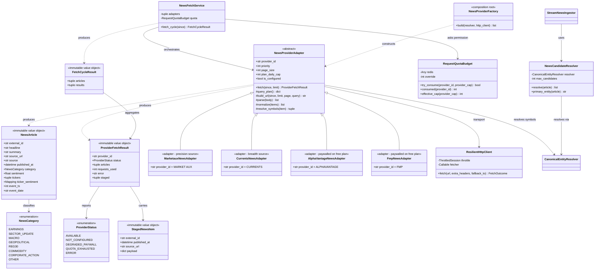

# 03 — Class Diagram, Domain Models & Repository Interfaces

> **Current deployment architecture:** Read [docs/04_SERVICE_BOUNDARIES.md](04_SERVICE_BOUNDARIES.md) first. It supersedes the legacy single-service layout, combined dossier, selective macro baseline, YAML runtime registry, and 30-minute news cadence below. Production services are `services/upstox/` (SQL/source ingestion) and `services/stockgraph/` (FalkorDB/LLM), with hourly news and API registration.

> Source of truth for Milestone 1+ code. `window=LAST_6M | LAST_1Y` only (no `from_date/to_date`, no all-time). Numerics are SQL-only via `ChartProviderAdapter`; graph holds news/snapshots/deals/holdings. Anomalies are SQL queries, never graph nodes.

## 1. Mermaid OOP Class Diagram

```mermaid
classDiagram
    class Window {
        <<enumeration>>
        LAST_6M
        LAST_1Y
    }
    class Cadence {
        <<enumeration>>
        STREAM_30M
        DAILY_OPEN
        DAILY_EOD
        MONTHLY
        BIMONTHLY
        QUARTERLY
    }
    class MarketSession {
        <<enumeration>>
        OPEN
        CLOSE
    }
    class OntologyRelationType {
        <<enumeration>>
        EXPOSED_TO
        SENSITIVE_TO_MACRO
        BELONGS_TO
        SUPPLIES_TO
        COMPETES_WITH
        RELATED_TO
    }
    class CorrelationType {
        <<enumeration>>
        CAUSAL_CHAIN
        MACRO_CONTAGION
        SECTOR_RIPPLE
        FOLLOW_UP
    }
    class DossierRequest {
        +str ticker
        +Window window
    }
    class StockDossierResponse {
        +str ticker
        +Window window
        +int start_ts
        +int end_ts
        +DirectNewsItem[] direct_news
        +IndirectNewsItem[] indirect_news
        +InstitutionalDealItem[] institutional_deals
        +MFShiftItem[] mf_shifts
        +QuarterlySnapshotItem[] quarterly_snapshots
        +GuidanceChunkItem[] guidance_chunks
        +QuantSummary quant_summary
    }
    class QuantSummary {
        +str vendor_id
        +datetime vendor_as_of
        +float latest_open
        +float latest_close
        +float latest_delivery_pct
        +float pe_5yr_percentile
    }
    class DirectNewsItem {
        +str id
        +str impact_type
        +float confidence
        +str rationale
        +str[] correlated_news_ids
    }
    class IndirectNewsItem {
        +str id
        +str via_node
        +str exposure_nature
        +float exposure_confidence
        +str exposure_rationale
    }
    class StockContextCard {
        +str ticker
        +str business_summary
        +str[] revenue_segments
        +str[] raw_material_inputs
        +str geographic_exposure
        +str latest_quarter_summary
        +str[] latest_guidance_highlights
        +str[] active_exposures
    }
    class InferredOntologyEdge {
        +str source_id
        +OntologyRelationType relation
        +str target_id
        +float confidence
        +str rationale
    }
    class InferredNewsStockImpact {
        +str news_id
        +str ticker
        +str impact_type
        +float confidence
        +str rationale
    }
    class InferredNewsCorrelation {
        +str new_news_id
        +str prior_news_id
        +CorrelationType correlation_type
        +float confidence
        +str rationale
        +int event_ts
    }
    class MacroFactorDetail {
        +str id
        +str description
        +str why_it_moves
        +str equity_transmission
        +str default_scope
    }
    class StockProfileProvider {
        +build_context_card(ticker: str) StockContextCard
    }
    class DynamicOntologyBuilder {
        +infer_edges(card: StockContextCard) InferredOntologyEdge[]
    }
    class NewsCorrelator {
        +correlate(news_id: str) InferredNewsCorrelation[]
    }
    class CanonicalEntityResolver {
        +resolve_stock(raw: str) str
        +resolve_registry(raw: str) str
    }
    class NewsDeduper {
        +canonicalize_url(url: str) str
        +deterministic_id(headline, ticker, date: str) str
        +exact_seen(url_hash: str) bool
        +near_dup_check(norm_headline, ticker, now_ts: int) dict
        +semantic_link_or_create(props, embedding, ticker, now_ts: int) dict
    }
    class NewsGraphExtractor {
        +extract(article: dict) EdgeSpec
    }
    class ChartProviderAdapter {
        <<abstract>>
        +get_eod_series(ticker, start, end: date) list
        +get_macro_series(keys, start, end: date) list
    }
    class BasePeriodicMacroIngestor {
        <<abstract>>
        +ingest_macro_indicators() IngestionResult
        +ingest_mf_holdings() IngestionResult
    }
    class VendorSyncService {
        +sync_window(ticker, window: Window) IngestRun
        +stage_raw(payload: dict) void
        +normalize_window(ticker, window: Window) int
    }
    class FalkorGraphRAGRepository {
        +ensure_indexes_and_constraints() list
        +get_temporal_subgraph(ticker, start_ts, end_ts: int, limit: int) dict
        +find_text_dup(norm_headline, ticker, window_secs: int, now_ts: int) dict
        +find_near_dup(embedding, ticker, now_ts: int) dict
        +merge_news_event(props: dict, embedding: list) dict
        +merge_stock_impact(news_id, ticker, impact_type, confidence, rationale, sentiment) dict
        +merge_news_shock(news_id, target_kind, target_id, confidence, rationale, sentiment) dict
        +rotate_validity_interval_node(ticker, new_ts: int, new_props: dict) dict
    }
    class TimescaleRepository {
        +init_schema() void
        +get_daily_range(ticker, start, end: date, session_type: str) list
        +get_anomalies(ticker, start, end: date) list
        +get_monthly_aggregates(ticker, window: Window) list
        +get_watermark(vendor_id, ticker, series: str) date
        +advance_watermark(vendor_id, ticker, series: str, last_date: date) void
        +stage_news_raw(provider_id, external_id, payload, published_at, source_url) void
        +get_news_watermark(provider_id) datetime
        +advance_news_watermark(provider_id, published_at) void
    }
    class SchedulerFactory {
        +build() AsyncIOScheduler
    }
    class StockContextService {
        +get_stock_dossier(ticker, window: Window) StockDossierResponse
    }

    DossierRequest --> Window : uses
    StockDossierResponse --> QuantSummary : contains
    StockContextService --> FalkorGraphRAGRepository : reads graph
    StockContextService --> TimescaleRepository : reads SQL
    StockContextService --> Window : resolve_window()
    VendorSyncService --> ChartProviderAdapter : fetches via
    VendorSyncService --> TimescaleRepository : stages/normalizes
    NewsGraphExtractor --> CanonicalEntityResolver : resolves via
    NewsGraphExtractor --> NewsDeduper : dedups via
    NewsGraphExtractor --> StockContextCard : injects context
    NewsGraphExtractor --> InferredNewsStockImpact : emits
    DynamicOntologyBuilder --> StockContextCard : injects context
    DynamicOntologyBuilder --> InferredOntologyEdge : emits
    DynamicOntologyBuilder --> OntologyRelationType : labels via
    NewsCorrelator --> InferredNewsCorrelation : emits
    NewsCorrelator --> CorrelationType : labels via
    StockProfileProvider --> StockContextCard : builds
    StockDossierResponse --> DirectNewsItem : contains
    StockDossierResponse --> IndirectNewsItem : contains
    SchedulerFactory --> VendorSyncService : schedules
```



### 1b. News Ingestion Slice (added with the news API adapters)



## 2. Pydantic Models (`services/*/src/*/domain/`)

`Window(str, Enum)`: `LAST_6M`, `LAST_1Y`. `resolve_window(window) -> (start_ts, end_ts)` is IST-aware (`Asia/Kolkata` start-of-day → UTC epoch).

`MarketSession(str, Enum)`: `OPEN`, `CLOSE`. `DailyStockMetricItem` captures 2 session rows per day.

`OntologyRelationType(str, Enum)`: `EXPOSED_TO`, `SENSITIVE_TO_MACRO`, `BELONGS_TO`, `SUPPLIES_TO`, `COMPETES_WITH`, `RELATED_TO` (commodity-to-commodity input/substitute links).

`CorrelationType(str, Enum)`: `CAUSAL_CHAIN`, `MACRO_CONTAGION`, `SECTOR_RIPPLE`, `FOLLOW_UP`.

`StockContextCard`: encapsulates a stock's fundamental profile (`business_summary`, `revenue_segments`, `raw_material_inputs`, `geographic_exposure`), `latest_quarter_summary`, `latest_guidance_highlights`, and `active_exposures` so the LLM always has complete company context when building ontology edges or routing news.

`InferredOntologyEdge`, `InferredNewsStockImpact`, `InferredNewsCorrelation`: structured LLM output schemas enforcing confidence scores (`0.0–1.0`), explicit `rationale` / `causal_rationale`, and canonical entity validation. `InferredOntologyEdge.source_id` accepts a ticker (stock edge) or commodity ID (`RELATED_TO` inter-link).

`MacroFactorDetail`: explainer card for a `:MacroFactor` node (`description`, `why_it_moves`, `equity_transmission`, `default_scope: BROAD | SELECTIVE`). Numeric series live in TimescaleDB; the *why-it-changed* narrative is sourced from official releases (MoSPI/RBI/Budget) + macro news via `(:NewsEvent)-[:ALTERS_MACRO]->(:MacroFactor)` — never fabricated.

`DossierRequest(ticker, window)`; `StockDossierResponse` as diagrammed. `DirectNewsItem` includes `impact_type` (`DIRECTLY_IMPACTS | INDIRECTLY_IMPACTS`), `confidence`, `rationale`, and `correlated_news_ids: list[str]`. `IndirectNewsItem` includes `exposure_nature`, `exposure_confidence`, and `exposure_rationale`. `QuantSummary` always carries `vendor_id + vendor_as_of` plus `latest_open` and `latest_close`.

Bootstrap registry IDs (commodity/macro/sector) live in `services/upstox/src/upstox_service/resources/ontology_seed.yaml`, not hardcoded enums; the service enums keep `Window`, `Cadence`, `MarketSession`, `OntologyRelationType`, `CorrelationType`, `DealType/Side`, `ActorCategory`, and `NewsCategory`. There is no `:Currency` node type — USD/INR forex is the `USD_INR_FX` macro factor.

## 3. Repository & Service Interfaces

```python
class ChartProviderAdapter(ABC):
    @abstractmethod
    def get_eod_series(self, ticker: str, start: date, end: date) -> list[dict]: ...
    @abstractmethod
    def get_macro_series(self, keys: list[str], start: date, end: date) -> list[dict]: ...

class BasePeriodicMacroIngestor(ABC):
    @abstractmethod
    async def ingest_macro_indicators(self) -> IngestionResult: ...
    @abstractmethod
    async def ingest_mf_holdings(self) -> IngestionResult: ...

class FalkorGraphRAGRepository:
    def ensure_indexes_and_constraints(self) -> list[str]: ...
    def get_temporal_subgraph(self, ticker: str, start_ts: int, end_ts: int, limit: int = 50) -> dict: ...
    def find_text_dup(self, norm_headline: str, ticker: str, window_secs: int, now_ts: int | None = None) -> dict | None: ...
    def find_near_dup(self, embedding: list[float], ticker: str, now_ts: int) -> dict | None: ...
    def merge_news_event(self, props: dict, embedding: list[float] | None = None) -> dict: ...
    def merge_stock_impact(self, news_id: str, ticker: str, impact_type: str, confidence: float,
                          rationale: str, sentiment: float | None = None) -> dict: ...
    def merge_news_shock(self, news_id: str, target_kind: str, target_id: str, confidence: float,
                         rationale: str, sentiment: float | None = None) -> dict: ...
    def rotate_validity_interval_node(self, ticker: str, new_ts: int, new_props: dict) -> dict: ...

class TimescaleRepository:
    async def init_schema(self) -> None: ...
    async def get_daily_range(self, ticker: str, start: date, end: date, session_type: str | None = None) -> list[Record]: ...
    async def get_anomalies(self, ticker: str, start: date, end: date, threshold: float = 1.8) -> list[Record]: ...
    async def get_monthly_aggregates(self, ticker: str, window: Window) -> list[Record]: ...
    async def get_watermark(self, vendor_id: str, ticker: str, series: str) -> date | None: ...
    async def advance_watermark(self, vendor_id: str, ticker: str, series: str, last_date: date) -> None: ...
    async def stage_news_raw(self, provider_id: str, external_id: str, payload: dict,
                             published_at: datetime | None = None, source_url: str | None = None) -> None: ...
    async def get_news_watermark(self, provider_id: str) -> datetime | None: ...
    async def advance_news_watermark(self, provider_id: str, published_at: datetime) -> None: ...

class NewsProviderAdapter(ABC):
    provider_id: str
    priority: int
    page_size: int
    plan_daily_cap: int

    def fetch(self, since: datetime, limit: int) -> ProviderFetchResult:
        """Never raises. Degrades to an empty result with a ProviderStatus."""
    def _query_plan(self) -> dict[str, int]:
        """Query kind -> page budget. A provider that runs both a targeted
        and a broad feed declares two kinds with their own budgets."""
    @abstractmethod
    def _build_url(self, since: datetime, limit: int, page: int, query: str = "default") -> str: ...
    @abstractmethod
    def _parse(self, body: str) -> list[dict]: ...

class NewsFetchService:
    def __init__(self, adapters: list[NewsProviderAdapter], timescale_repo=None, quota=None): ...
    async def fetch_cycle(self, since: datetime | None = None) -> FetchCycleResult: ...

class NewsCandidateResolver:
    def resolve(self, article: NewsArticle) -> list[str]: ...
    def primary_entity(self, article: NewsArticle) -> str: ...

class SchedulerFactory:
    @staticmethod
    def build(dsn: str, redis_url: str) -> AsyncIOScheduler:
        """Durable jobstore + coalesce=True, max_instances=1, misfire_grace_time=300.
        Each job body takes a Redis NX lock and logs to ingest_runs."""
```

## 4. Method-Signature Notes

- `get_temporal_subgraph` implements `docs/02 §3.2` (canonical news only, per-section `LIMIT`, no anomaly branch). Section limits are ints clamped to 1–200 and rendered as literal `LIMIT {n}` — FalkorDB rejects parameterized `LIMIT`/`SKIP`.
- `NewsDeduper` methods implement `docs/02 §3.3–§3.4`: L2 `near_dup_check` (normalized headline, `dedup_window_hours`, no embedding spent) and L3 `semantic_link_or_create` (`db.idx.vector.queryNodes`, cosine > `dedup_cosine_threshold` → `[:DUPLICATE_OF]`).
- `get_anomalies` is `WHERE abs(delivery_20d_zscore) >= 1.8` over the resolved window — the only anomaly API. No graph writes.
- `rotate_validity_interval_node` closes the prior node, creates the new one, and links `[:SUPERSEDES]` in separate statements (no `FOREACH`); each statement projects scalar business ids and the method returns `{"new_id", "old_id"}`; must run under the job's Redis lock.
- `NewsArticle` (`services/upstox/src/upstox_service/domain/models.py`) is the source-side article contract transported through the versioned event schema. `event_ts` and `event_date` are derived values: `event_ts` is the UTC epoch and `event_date` the IST calendar date (Rule 3 windows are IST-aware). `category` is written to the graph as the enum's **VALUE** — on Python 3.11+ `str(NewsCategory.EARNINGS)` is `"NewsCategory.EARNINGS"`, not `"EARNINGS"`.
- `NewsProviderAdapter.fetch()` is the only news-provider touchpoint. It never raises: a missing key reports `NOT_CONFIGURED`, an exhausted daily budget reports `QUOTA_EXHAUSTED`, a plan refusal (HTTP 200 or 402 with a notice in the body) reports `DEGRADED_PAYWALL`, and a transport failure reports `ERROR` — always with an empty article list.
- `NewsCandidateResolver.primary_entity()` is the **dedup bucket** and is derived from the article TEXT, never from the provider's entity tags. The same story arriving from two providers must resolve to the same bucket, or L2/L3 cannot see them as duplicates and the graph gains two `:NewsEvent` nodes for one story. Provider tags drive ROUTING only.
- `merge_stock_impact` / `merge_news_shock` take `sentiment` OUTSIDE the LLM schema: the provider's per-entity score is written to `r.sentiment` with `coalesce($sentiment, r.sentiment)` so a later write without a score cannot erase a known one. The impact edges write `r.causal_rationale`; the dossier reads it back as `rationale`.
- `InferredNewsStockImpact.news_id` / `InferredNewsCorrelation.new_news_id` are plumbing the CALLER owns. The extractor and correlator always overwrite them with the authoritative id, and a mangled value (e.g. a numeric echo of a 40-char sha1) is coerced rather than failing the batch. `prior_news_id` is validated against the candidate set actually offered.
- The LLM-facing schemas default every field and coerce explicit `null`s, so one malformed verdict costs THAT verdict only. The processors enforce the real rules instead: known impact type / correlation type, canonical entity, confidence floor AND range, non-empty rationale, known prior id. A confidence outside 0.0-1.0 is dropped, not clamped.
- `redact_url()` masks credential query parameters (`api_key`, `apikey`, `api_token`, `token`, `access_token`, `key`) before a URL reaches a log line - provider keys travel in the query string.
- A provider whose plan refuses the endpoint reports `DEGRADED_PAYWALL`; the fetch service remembers that verdict and stops spending daily quota re-probing a dead endpoint.
