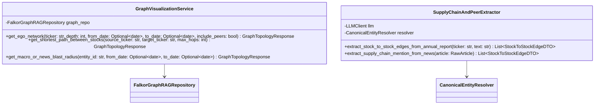

# 02 — System Design, Database Schemas & Query Specifications

## 1. End-to-End Architecture Diagram

```text
+-----------------------------------------------------------------------------------+
|                        1. CRON SCHEDULER & INGESTION LAYER                        |
|  [APScheduler / CLI Workers]                                                      |
|   ├── StreamNewsIngestor    (Every 30m) : RSS Feeds + NSE/BSE Reg-30 Filings      |
|   ├── DailyEODIngestor      (7:00 PM)   : Bhavcopy, FII/DII, Bulk/Insider, PE, FX |
|   ├── PeriodicMacroIngestor (Monthly/BM): AMFI MF Holdings, CPI, RBI Repo, Sector |
|   └── QuarterlyIngestor     (Quarterly) : XBRL P&L/BS/CF, Concall PDFs, SHP/Pledge|
+-----------------------------------------+-----------------------------------------+
                                          |
                                          v
+-----------------------------------------------------------------------------------+
|                      2. PROCESSING & GRAPH EXTRACTION LAYER                       |
|   ├── CanonicalEntityResolver : Maps raw strings -> NSE Ticker / ISIN / Macro ID  |
|   ├── QuantAnomalyDetector    : Computes 20D Delivery Z-Score & 5Y PE Percentile  |
|   └── NewsGraphExtractor (LLM): Extracts 1-Hop Stock vs 2-Hop Macro/Commodity Edge|
+--------------------+-----------------------------------------+--------------------+
                     |                                         |
                     v (Continuous Numeric Series)             v (Causal Graph + Vector RAG)
+----------------------------------------+ +----------------------------------------+
|     3A. PERSISTENT RELATIONAL DB       | |     3B. UNIFIED GRAPH + VECTOR DB      |
|     [PostgreSQL 16 + TimescaleDB]      | |              [FalkorDB]                |
|  • daily_stock_metrics                 | |  • Static: Stock, Sector, Commodity,   |
|  • daily_macro_and_flows               | |    Currency, MacroFactor               |
|  • institutional_deals_raw             | |  • Point-in-Time: NewsEvent (vecf32),  |
|  • monthly_mf_holdings_raw             | |    DailyAnomalyEvent, EXECUTED_DEAL    |
|  • quarterly_financials                | |  • Validity-Interval: QuarterlySnapshot|
|                                        | |    GuidanceChunk (vecf32), MF Holding  |
+--------------------+-------------------+ +-------------------+--------------------+
                     |                                         |
                     +--------------------+--------------------+
                                          |
                                          v
+-----------------------------------------------------------------------------------+
|                 4. STOCK CONTEXT SERVICE (FastAPI + FastMCP Server)               |
|   • Resolves [from_date, to_date] -> [start_ts, end_ts] (or [0, 9999999999])      |
|   • Merges 1-Hop + 2-Hop FalkorDB Subgraph + Vector Chunks + SQL Quant Summary    |
|   • Returns StockDossierResponse JSON to Upstream AI Agents / Phase 2 Bot         |
+-----------------------------------------------------------------------------------+
```

---

## 2. FalkorDB Graph Topology & How Everything Connects

```text
                    +------------------------------------------+
                    |              :NewsEvent                  |
                    |  id, headline, summary, category         |
                    |  sentiment (-1 to +1), event_ts: int     |
                    |  embedding: vecf32(1536)                 |
                    +----+----------------+---------------+----+
                         |                |               |
   [:DIRECTLY_IMPACTS]   |                | [:SHOCKS]     | [:IMPACTS_SECTOR /
   (1-Hop Stock News)    |                v               v  :ALTERS_MACRO]
                         |        +---------------+  +---------------+
                         |        |  :Commodity   |  |    :Sector    |
                         |        |  :Currency    |  |  :MacroFactor |
                         |        | (BRENT_CRUDE, |  | (METALS, IT,  |
                         |        |  HRC_STEEL,   |  |  RBI_REPO,    |
                         |        |  USD_INR)     |  |  INDIA_CPI)   |
                         |        +-------+-------+  +-------+-------+
                         |                ^                  ^
                         |                | [:EXPOSED_TO]    | [:BELONGS_TO /
                         v                | (Static Seeded)  |  :SENSITIVE_TO_MACRO]
+--------------------+  +-----------------+------------------+  +--------------------+
| :DailyAnomalyEvent |<-+               :Stock               +->| :QuarterlySnapshot |
| • metric_type      |  | ticker: "TATASTEEL"                |  | • quarter: "Q2FY27"|
| • value, z_score   |  | isin: "INE081A01020"               |  | • rev_yoy_pct      |
| • event_ts: int    |  | latest_pe, latest_pb, latest_ev_eb |  | • ebitda_margin    |
+--------------------+  +-----------------+------------------+  | • pledge_pct       |
                                          ^                     | • debt_to_equity   |
            +-----------------------------+---------------+     | • fcf_cr           |
            |                             |               |     | • valid_from_ts    |
            | [:EXECUTED_DEAL]            | [:UPDATED_    |     | • valid_to_ts      |
            | (Point-in-Time: event_ts)   |   HOLDING]    |     +---------+----------+
            v                             v               v               | [:SUPERSEDES]
+-----------------------+   +-----------------------+   +-----------------+-------+
| :InstitutionalActor   |   | :MutualFundHouse      |   | :GuidanceChunk (Vector) |
| • name                |   | • amc_id, name        |   | • concall_summary       |
| • category (FII/PROM) |   | • Edge: valid_from_ts |   | • order_book_cr         |
| • Edge: BULK/INSIDER  |   |   valid_to_ts, delta  |   | • valid_from_ts/to_ts   |
+-----------------------+   +-----------------------+   +-------------------------+
```

---

## 3. FalkorDB Initialization & OpenCypher Query Templates

### 3.1 Index Creation Cypher Script
Run on service startup in `FalkorGraphRAGRepository.ensure_indexes_and_constraints()`:
```cypher
CREATE INDEX FOR (s:Stock) ON (s.ticker);
CREATE INDEX FOR (c:Commodity) ON (c.id);
CREATE INDEX FOR (fx:Currency) ON (fx.id);
CREATE INDEX FOR (m:MacroFactor) ON (m.id);
CREATE INDEX FOR (sec:Sector) ON (sec.id);

// Temporal Range Indexes
CREATE INDEX FOR (n:NewsEvent) ON (n.event_ts);
CREATE INDEX FOR (a:DailyAnomalyEvent) ON (a.event_ts);
CREATE INDEX FOR (q:QuarterlySnapshot) ON (q.valid_from_ts);
CREATE INDEX FOR (q:QuarterlySnapshot) ON (q.valid_to_ts);
CREATE INDEX FOR (g:GuidanceChunk) ON (g.valid_from_ts);
CREATE INDEX FOR (g:GuidanceChunk) ON (g.valid_to_ts);

// Vector Indexes for Semantic RAG
CREATE VECTOR INDEX FOR (n:NewsEvent) ON (n.embedding) OPTIONS {dimension: 1536, similarityFunction: 'cosine'};
CREATE VECTOR INDEX FOR (g:GuidanceChunk) ON (g.embedding) OPTIONS {dimension: 1536, similarityFunction: 'cosine'};
```

### 3.2 Master Temporal Subgraph Retrieval Query
Used by `StockContextService.get_stock_dossier()` for both date-bounded (`[from_date, to_date]`) and unfiltered (`[0, 9999999999]`) requests:
```cypher
MATCH (s:Stock {ticker: $ticker})

// 1. Direct 1-Hop News in [start_ts, end_ts]
OPTIONAL MATCH (n1:NewsEvent)-[r1:DIRECTLY_IMPACTS]->(s)
WHERE n1.event_ts >= $start_ts AND n1.event_ts <= $end_ts

// 2. Indirect 2-Hop Contagion News (via Commodity, Currency, Sector, Macro) in [start_ts, end_ts]
OPTIONAL MATCH (s)-[exp:EXPOSED_TO|BELONGS_TO|SENSITIVE_TO_MACRO]->(bridge)<-[r2:SHOCKS|IMPACTS_SECTOR|ALTERS_MACRO]-(n2:NewsEvent)
WHERE n2.event_ts >= $start_ts AND n2.event_ts <= $end_ts

// 3. Daily Quant Anomalies in [start_ts, end_ts]
OPTIONAL MATCH (s)-[:TRIGGERED_ANOMALY]->(anom:DailyAnomalyEvent)
WHERE anom.event_ts >= $start_ts AND anom.event_ts <= $end_ts

// 4. Bulk, Block & Insider Deals in [start_ts, end_ts]
OPTIONAL MATCH (inst:InstitutionalActor)-[deal:EXECUTED_DEAL]->(s)
WHERE deal.event_ts >= $start_ts AND deal.event_ts <= $end_ts

// 5. Monthly Mutual Fund Holdings Overlapping [start_ts, end_ts]
OPTIONAL MATCH (mf:MutualFundHouse)-[mh:UPDATED_HOLDING]->(s)
WHERE mh.valid_from_ts <= $end_ts AND mh.valid_to_ts >= $start_ts

// 6. Quarterly Snapshots & Guidance Overlapping [start_ts, end_ts]
OPTIONAL MATCH (s)-[:HAS_QTR_STATE]->(qtr:QuarterlySnapshot)
WHERE qtr.valid_from_ts <= $end_ts AND qtr.valid_to_ts >= $start_ts

OPTIONAL MATCH (s)-[:ISSUED_GUIDANCE]->(gd:GuidanceChunk)
WHERE gd.valid_from_ts <= $end_ts AND gd.valid_to_ts >= $start_ts

RETURN s,
       collect(DISTINCT {id: n1.id, date: n1.event_date, ts: n1.event_ts, headline: n1.headline, summary: n1.summary, category: n1.category, sentiment: r1.sentiment}) AS direct_news,
       collect(DISTINCT {id: n2.id, date: n2.event_date, ts: n2.event_ts, via_node: bridge.id, exposure_type: exp.type, margin_impact: exp.margin_impact, headline: n2.headline, sentiment: r2.sentiment}) AS indirect_news,
       collect(DISTINCT properties(anom)) AS daily_anomalies,
       collect(DISTINCT {actor: inst.name, actor_cat: inst.category, deal_type: deal.deal_type, side: deal.side, qty: deal.qty, value_cr: deal.value_cr, date: deal.event_date, ts: deal.event_ts}) AS institutional_deals,
       collect(DISTINCT {amc: mf.name, month: mh.month, delta_stake_pct: mh.delta_stake_pct, from_ts: mh.valid_from_ts}) AS mf_shifts,
       collect(DISTINCT properties(qtr)) AS quarterly_snapshots,
       collect(DISTINCT {id: gd.id, quarter: gd.quarter, concall_summary: gd.concall_summary, order_book_cr: gd.order_book_cr, from_ts: gd.valid_from_ts}) AS guidance_chunks
```

### 3.3 Bi-Temporal Validity Rotation Query (`rotate_validity_interval_node`)
When a new quarter's results or guidance arrives at `valid_from_ts = $new_ts`:
```cypher
MATCH (s:Stock {ticker: $ticker})
OPTIONAL MATCH (s)-[r_old:HAS_QTR_STATE]->(old_q:QuarterlySnapshot {is_latest: true})
SET old_q.is_latest = false,
    old_q.valid_to_ts = $new_ts - 1
CREATE (new_q:QuarterlySnapshot $new_props)
SET new_q.valid_from_ts = $new_ts,
    new_q.valid_to_ts = 9999999999,
    new_q.is_latest = true
CREATE (s)-[:HAS_QTR_STATE]->(new_q)
FOREACH (_ IN CASE WHEN old_q IS NOT NULL THEN [1] ELSE [] END |
    CREATE (new_q)-[:SUPERSEDES]->(old_q)
)
RETURN new_q
```

---

## 3. Graph Visualization Service & DTO Extensions

### 3.1 Additional Classes in Mermaid Diagram


### 3.2 Pydantic Schemas for Graph Frontend (`src/domain/schemas_graph_ui.py`)
```python
from typing import List, Optional, Dict, Any, Literal
from pydantic import BaseModel, Field


class StockToStockEdgeDTO(BaseModel):
    source_ticker: str
    target_ticker: str
    relationship_type: Literal["SUPPLIES_TO", "COMPETES_WITH", "OWNS_STAKE_IN"]
    segment_or_component: str
    dependency_strength: Literal["HIGH", "MEDIUM", "LOW"] = "MEDIUM"
    stake_pct: Optional[float] = None
    source_evidence: Optional[str] = None
    updated_ts: int


class GraphNodeUI(BaseModel):
    id: str = Field(..., description="Namespaced ID, e.g., STOCK:TATASTEEL or COMMODITY:BRENT_CRUDE")
    label: str
    node_type: Literal[
        "Stock", "PeerStock", "BusinessGroup", "Sector",
        "Commodity", "Currency", "MacroFactor",
        "NewsEvent", "InstitutionalActor", "MutualFundHouse",
        "QuarterlySnapshot", "GuidanceChunk", "DailyAnomalyEvent"
    ]
    hop_distance: int = 0
    visual_size: float = 16.0
    event_ts: Optional[int] = None
    valid_from_ts: Optional[int] = None
    valid_to_ts: Optional[int] = None
    properties: Dict[str, Any] = Field(default_factory=dict)


class GraphLinkUI(BaseModel):
    id: str
    source: str
    target: str
    relationship: str
    polarity: Literal["POSITIVE", "NEGATIVE", "INVERSE", "DIRECT", "NEUTRAL"] = "NEUTRAL"
    weight: float = 1.0
    event_ts: Optional[int] = None
    properties: Dict[str, Any] = Field(default_factory=dict)


class GraphTopologyResponse(BaseModel):
    center_node_id: Optional[str] = None
    window: Dict[str, Any]
    total_nodes: int
    total_links: int
    nodes: List[GraphNodeUI]
    links: List[GraphLinkUI]
```

## 4. PostgreSQL / TimescaleDB DDL Schema

```sql
CREATE EXTENSION IF NOT EXISTS timescaledb;

CREATE TABLE daily_stock_metrics (
    trade_date DATE NOT NULL,
    ticker VARCHAR(20) NOT NULL,
    open_price NUMERIC(12, 2),
    high_price NUMERIC(12, 2),
    low_price NUMERIC(12, 2),
    close_price NUMERIC(12, 2) NOT NULL,
    volume BIGINT NOT NULL,
    delivery_qty BIGINT NOT NULL,
    delivery_pct NUMERIC(5, 2) NOT NULL,
    delivery_20d_avg NUMERIC(5, 2),
    delivery_20d_zscore NUMERIC(6, 2),
    pe_ratio NUMERIC(8, 2),
    pb_ratio NUMERIC(8, 2),
    ev_ebitda NUMERIC(8, 2),
    pe_5yr_percentile NUMERIC(5, 2),
    PRIMARY KEY (trade_date, ticker)
);

SELECT create_hypertable('daily_stock_metrics', 'trade_date', if_not_exists => TRUE);

CREATE TABLE daily_macro_and_flows (
    trade_date DATE NOT NULL PRIMARY KEY,
    brent_crude_usd NUMERIC(10, 2),
    hrc_steel_inr NUMERIC(12, 2),
    coking_coal_usd NUMERIC(10, 2),
    usd_inr NUMERIC(8, 4),
    fii_net_cash_cr NUMERIC(12, 2),
    dii_net_cash_cr NUMERIC(12, 2)
);

CREATE TABLE quarterly_financials (
    ticker VARCHAR(20) NOT NULL,
    quarter_label VARCHAR(10) NOT NULL,
    published_date DATE NOT NULL,
    valid_from_ts BIGINT NOT NULL,
    revenue_cr NUMERIC(14, 2),
    rev_yoy_pct NUMERIC(6, 2),
    ebitda_cr NUMERIC(14, 2),
    ebitda_margin_pct NUMERIC(6, 2),
    pat_cr NUMERIC(14, 2),
    pat_yoy_pct NUMERIC(6, 2),
    debt_to_equity NUMERIC(6, 2),
    operating_cash_flow_cr NUMERIC(14, 2),
    free_cash_flow_cr NUMERIC(14, 2),
    order_book_cr NUMERIC(14, 2),
    promoter_holding_pct NUMERIC(5, 2),
    promoter_pledge_pct NUMERIC(5, 2),
    fii_holding_pct NUMERIC(5, 2),
    dii_holding_pct NUMERIC(5, 2),
    PRIMARY KEY (ticker, quarter_label)
);
```