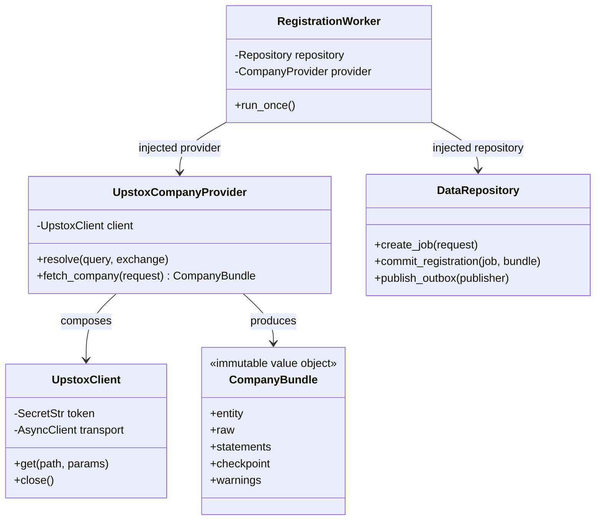

# Service architecture and operating guide

This specification supersedes the older single-service folder layout, combined
dossier API, YAML-as-runtime-registry, selective macro baseline, and 30-minute
cadence in documents 01–03. Phase 2 trading decisions and order execution remain
deferred. Deployable code lives exclusively under `services/`; repository-root
scripts and tests are cross-service operational tooling, not deployment entrypoints.

## Ownership and layout

Two installable Python packages live in one uv workspace, with one root lockfile.
Each image installs only its own package and dependencies. No service imports
the sibling package or reads the sibling database.

| Responsibility | Upstox / Data Service | StockGraph |
|---|---|---|
| Database | PostgreSQL/TimescaleDB | FalkorDB |
| Source integrations | Upstox, existing news providers, exchange adapters | None |
| Registry | Canonical SQL catalog and revision history | Committed catalog projection |
| Financial information | Immutable raw payloads, statements, two daily checkpoints | Narrative context and source references only |
| Processing | Fetching, normalization, durable jobs/outbox | Embeddings, LLM relationships, deduplication, correlation |
| Read API | Financial data | Graph nodes, edges and related news |

Both services use Redis for transport/coordination. Provider quotas and LLM spend
ledgers are preserved across project resets. Compose enables AOF with
`appendfsync=always` so a stream write is persisted before its SQL outbox row
can be marked published.

```text
services/upstox/src/upstox_service/
  domain/                         # provider-independent contracts/resolver
  application/ingestion/          # news fetching and checkpoint orchestration
  application/stock_registration.py
  adapters/providers/upstox/      # authenticated HTTP, instruments, fundamentals
  adapters/providers/news/        # existing news providers
  adapters/repositories/timescale/
  adapters/api/                   # registration, catalog, financial reads
  runtime/                        # API, worker, scheduler, bootstrap
  resources/ontology_seed.yaml    # packaged empty-registry bootstrap
services/stockgraph/src/stockgraph/
  domain/                         # graph/API/event contracts
  application/ingestion/          # committed-event processing
  application/processors/         # ontology, news routing/dedup/correlation
  application/graph_queries/
  adapters/repositories/falkor/
  adapters/llm/
  adapters/messaging/             # Redis Streams consumption/recovery
  adapters/api/                   # source-service client and MCP
  runtime/                        # graph API and separate graph worker
```

## Flow, APIs and failure states

1. `POST http://localhost:8000/api/v1/stocks` with
   `{"query":"RELIANCE","strengths":[],"business_exclusions":[]}` delegates
   registration to the Data Service at port 8001. It responds **202**, with a
   durable job ID; it does not wait for an LLM call.
2. The Data worker resolves an official instrument identity, fetches profile and
   supported statements/price data, and commits raw SQL data, catalog revision,
   and projection event in the **same SQL transaction**. Optional unavailable
   datasets are reported as warnings, never fabricated.
3. The SQL outbox publisher writes `stockgraph:events:v1`, field `event` containing
   JSON conforming to `contracts/events-v1.schema.json`. Delivery is at least once;
   event IDs, entity revisions and graph MERGEs make replay safe.
4. StockGraph projects canonical identities, connects all stock/macro pairs,
   embeds profiles, runs context-aware inference, and checks existing canonical
   news from the past 365 days. The graph worker acknowledges only after success.
5. `GET /api/v1/jobs/{job_id}` distinguishes `pending`, `data_collection`,
   `graph_processing`, `completed`, and `failed`. Disabled/budget-exhausted/broken
   inference is not reported as completed. Pending stream messages are retried
   after worker recovery; upstream news is not fetched again for graph replay.

Data-service endpoints also include `GET /api/v1/entities`,
`POST /api/v1/entities/Commodity`, `/MacroFactor`, `/Sector`, and
`GET /api/v1/stocks/{ticker}/financials?window=LAST_6M` (or `LAST_1Y`).
Register stocks through the stock-registration endpoint, not free-text entity IDs.
Inspect each service's `/docs` or `/openapi.json` for request/response schemas.

The graph endpoint is:

```text
GET /api/v1/stocks/RELIANCE/context?window=LAST_1Y&limit=50&offset=0
```

It returns `nodes`, `edges`, `direct_news`, `indirect_news`, and processing status.
Each relationship includes confidence, rationale and available provenance. An
indirect path includes both stock→commodity/macro exposure and news→shock edges,
even when the article does not name the stock. Follow `pagination.next_offset`
and preserve `pagination.as_of_ts` until every section's `has_more` is false.
Pagination snapshots expire after one hour by default; restart pagination if
the API rejects an expired snapshot.
Only `LAST_6M` and `LAST_1Y` windows are supported; no arbitrary date-range or
all-time API is added. Pagination is not a guarantee against concurrent graph
updates; callers should retry after registration completes for a consistent view.
This is graph-ready JSON, not a frontend visualization.

## Scheduling and graph rules

- A separate durable scheduler fetches news at **minute zero every hour**, IST.
  Redis locks, lease renewal, single-flight defaults, ingest-run logs and existing
  daily provider quotas are retained. Raw news is committed before graph work.
- Two daily price checkpoints remain: OPEN around 09:30 IST and CLOSE around
  19:00 IST. Official NSE Bhavcopy remains the primary delivery/turnover source;
  Upstox is not assumed to provide every requested financial/macro/delivery field.
  No tick/minute storage, options, order execution, or trading engine is added.
- Bootstrap creates exactly five stocks, five commodities, seven macro factors,
  and twelve sectors only when the SQL registry is empty. Startup thereafter
  does not overwrite API-maintained data. Keep the packaged seed in sync with
  the root compatibility seed when intentionally changing bootstrap defaults.
- Every stock links to every macro by policy; five seed stocks produce 35
  baseline stock/macro pairs. Macro explainer changes create interval-versioned
  history and `SUPERSEDES` links; unchanged mentions do not rotate versions.
- Typed LLM edges must resolve to committed canonical IDs and meet the configured
  confidence threshold (default 0.65). Prompts include business profiles, strengths,
  exclusions, available quarterly/guidance context and active exposures. Routing
  covers all registered stocks using token-aware batches, not a fixed eight-stock
  cap. Curated commodity exposures/inter-links remain an initial baseline.
- Graph reads exclude duplicate news and use bounded event/validity windows.
  Numeric financial series stay SQL-only. Direct database edits bypass this
  application/event contract and are not automatically inferred.

## OOP design of the Upstox integration



Credentials and transport policy stay inside the client; domain/application
objects do not expose tokens or import a vendor SDK. Future option/order-history
modules can compose the same client without coupling StockGraph to Upstox.

## Running, testing and safe reset

```powershell
uv sync --all-packages --group dev --inexact
docker compose up -d --build
uv run --all-packages pytest -q
```

For local Python processes, start the database containers only and run these in
separate terminals from the repository root (so the git-ignored `.env` is loaded):

```powershell
docker compose up -d falkordb timescale redis
uv run --package upstox-service upstox-api
uv run --package upstox-service upstox-worker
uv run --package upstox-service upstox-scheduler
uv run --package stockgraph-service uvicorn stockgraph.runtime.api:create_app --factory --port 8000
uv run --package stockgraph-service stockgraph-worker
```

Enable `LLM_ENABLED=true` and configure the chosen provider key for semantic
processing. Keep it false for offline tests. APIs are development/internal APIs;
add authentication and network controls before exposing them externally.

The graph MCP entrypoint is `uv run --package stockgraph-service --inexact stockgraph-mcp`
(stdio transport). It exposes graph context, not a combined SQL dossier.

Stop project API/workers/scheduler before a reset. `python -m scripts.project_data`
creates an integrity-checked local ZIP with SQL binary COPY data, graph DUMP and
project processing keys. `--reset --writers-stopped --confirm stockgraph/stock_graph`
backs up first, then clears only allowlisted local application data. No volume
deletion, database drop, Redis FLUSH, or unrelated graph removal occurs.
`--restore backups/<file>.zip --writers-stopped --confirm stockgraph/stock_graph`
backs up the current state before restoring an archive to the same local targets.
Backups are git-ignored and may contain licensed data; protect them accordingly.
