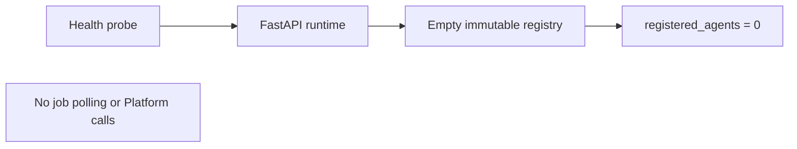
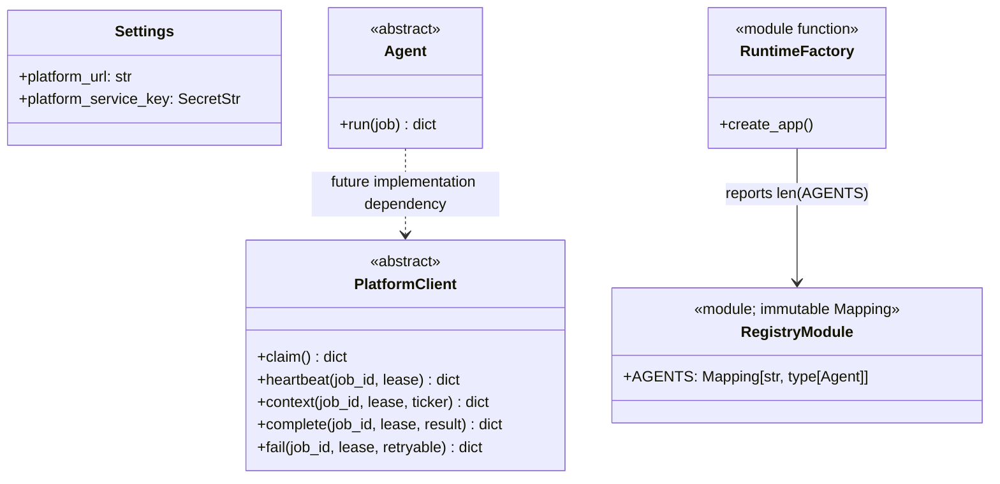

# Agents service template system design

Package: `services/agents/` (`marketgraph-agents`). This package is not an
executing agent service. Its opt-in `agents-template` Compose profile serves a
health endpoint on localhost port 8005 and reports `execution_enabled: false`
with an empty registry.

## Current system design

Normal Compose startup excludes the template. The health application does not
need a database, Redis, LLM key, broker credential or Platform service key. There
is no scheduler, job-consumer loop, claim/heartbeat callback or concrete handler.

## OOP class diagram

## Future transport boundary

When real handlers are specified, the intended transport is Platform REST:
`X-Agent-Key` authenticates the machine and `X-Job-Lease` scopes each context,
heartbeat, completion and failure request. Platform remains authoritative for
account permissions, source selection, citations and alerts. Agents will not
connect directly to SQL/graph stores or receive user broker credentials. Existing
separately hosted agent deployments remain independent of this empty package.
