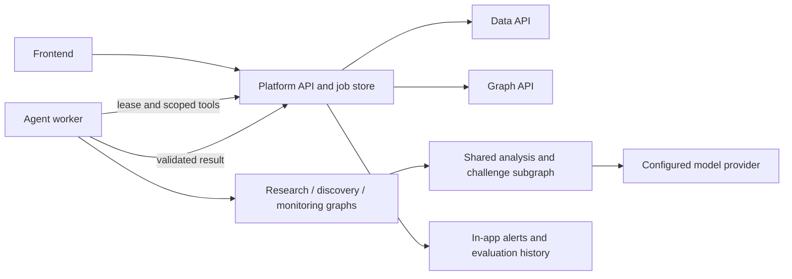

# Agents service architecture

Package `services/agents/` contains three LangGraph workflows. A separate opt-in worker claims developer-owned Platform jobs and dispatches the research, discovery, or monitoring graph. The health API remains a separate process and does not claim work.

Platform owns permissions, evidence registration, model-cost reservations, jobs, evaluation checkpoints, and alerts. Agents do not access application databases or broker credentials. Every graph uses an in-memory checkpointer scoped to its job attempt; after process or lease loss a new attempt reloads evidence through Platform. Provider calls are reserved before execution and validated before completion.

See [the agent guide](../../services/agents/README.md) for configuration, limits, and pilot status.
