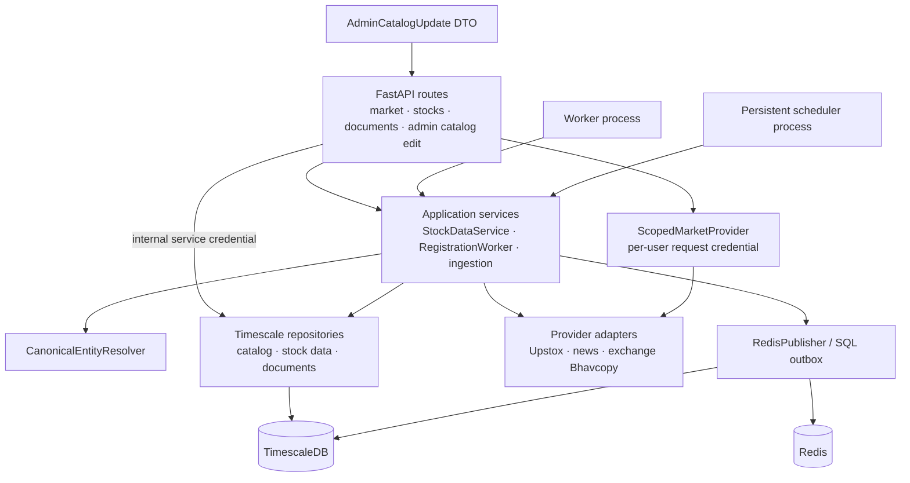

# Data Service system design

Package: `services/upstox/` (`upstox-service`), deployed processes: `data-api`,
`data-worker`, and `data-scheduler`.

## Responsibilities

Data is the owner of normalized market/source information and canonical SQL
identities. It stores source payloads and market series in TimescaleDB, publishes
canonical changes through a transactional outbox, and serves bounded REST reads.
It does not own user accounts, plan decisions, graph relationships, embeddings or
trade orders. User-facing access goes through Platform; internal routes require
the shared service credential.

### Components

The scheduled worker and API are separate processes. The scheduler owns durable
cadence and single-flight dispatch; the worker performs registration and ingestion.
Provider HTTP credentials and retry/timeout behavior stay inside provider adapters.

## Application class diagram

Application services receive structural protocols from `application/ports.py`.
The API, worker and scheduler assemble concrete adapters. The existing SQL
repository owns transactions; narrow repository adapters expose each workflow's
operations while retaining atomic source/outbox commits.

```mermaid
classDiagram
    class DataApiRoutes {
      <<FastAPI routes>>
    }
    class StockRegistrationSubmissionService {
      +submit(request)
    }
    class RegistrationWorker {
      +run_once()
    }
    class RegistrationJobPort {
      <<Protocol>>
      +create_job(request)
      +claim_job()
      +commit_company()
      +fail_job()
    }
    class CompanyProviderPort {
      <<Protocol>>
      +fetch_company(request)
    }
    class StockDataService {
      +list_stocks()
      +stock()
      +shareholding()
      +candles()
    }
    class StockDataRepositoryPort {
      <<Protocol>>
    }
    class StockDataProviderPort {
      <<Protocol>>
    }
    class ManualNewsSubmissionService {
      +submit(request)
    }
    class NewsIngestionCoordinator {
      +fetch_cycle()
    }
    class NewsFetchService {
      +fetch_cycle()
      +replay_staged()
    }
    class PendingNewsReviewService {
      +replay_pending()
    }
    class NewsEligibilityGate {
      +decide(article)
    }
    class NewsProviderPort {
      <<Protocol>>
      +fetch()
      +normalize_staged()
    }
    class NewsCommitPort {
      <<Protocol>>
      +commit_news(result)
    }
    class RequestQuotaPort {
      <<Protocol>>
      +try_consume(provider, cap)
    }
    class CheckpointCollectionService {
      +collect(session)
    }
    class PriceCheckpointProviderPort {
      <<Protocol>>
    }
    class BhavcopyProviderPort {
      <<Protocol>>
    }
    class CheckpointRepositoryPort {
      <<Protocol>>
    }
    class RegistrationRepository
    class StockDataRepository
    class NewsRepository
    class CheckpointRepository
    class UpstoxCompanyProvider
    class UpstoxStockDataProvider
    class UpstoxPriceCheckpointAdapter
    class NseBhavcopyAdapter
    class NewsProviderAdapter
    class RequestQuotaBudget

    DataApiRoutes --> StockRegistrationSubmissionService
    DataApiRoutes --> StockDataService
    DataApiRoutes --> ManualNewsSubmissionService
    StockRegistrationSubmissionService --> RegistrationJobPort
    RegistrationWorker --> RegistrationJobPort
    RegistrationWorker --> CompanyProviderPort
    StockDataService --> StockDataRepositoryPort
    StockDataService --> StockDataProviderPort
    ManualNewsSubmissionService --> NewsCommitPort
    ManualNewsSubmissionService --> NewsEligibilityGate
    NewsIngestionCoordinator *-- NewsFetchService
    NewsIngestionCoordinator *-- PendingNewsReviewService
    NewsFetchService --> NewsProviderPort
    NewsFetchService --> RequestQuotaPort
    NewsFetchService --> NewsEligibilityGate
    PendingNewsReviewService --> NewsProviderPort
    PendingNewsReviewService --> NewsCommitPort
    PendingNewsReviewService --> NewsEligibilityGate
    CheckpointCollectionService --> PriceCheckpointProviderPort
    CheckpointCollectionService --> BhavcopyProviderPort
    CheckpointCollectionService --> CheckpointRepositoryPort
    RegistrationRepository ..|> RegistrationJobPort
    StockDataRepository ..|> StockDataRepositoryPort
    NewsRepository ..|> NewsCommitPort
    CheckpointRepository ..|> CheckpointRepositoryPort
    UpstoxCompanyProvider ..|> CompanyProviderPort
    UpstoxStockDataProvider ..|> StockDataProviderPort
    UpstoxPriceCheckpointAdapter ..|> PriceCheckpointProviderPort
    NseBhavcopyAdapter ..|> BhavcopyProviderPort
    NewsProviderAdapter ..|> NewsProviderPort
    RequestQuotaBudget ..|> RequestQuotaPort
```

## Storage and flow

- `vendor_quotes_raw`, `news_raw`, documents and provider responses are retained
  before normalization or graph inference.
- Numeric series, canonical SQL catalog and registration/ingestion jobs remain
  Data-owned. Daily stock candle reads do not become graph nodes.
- Source adapters normalize identifiers through the canonical resolver; unresolved
  stock IDs are rejected instead of inventing new canonical identities.
- A registration transaction commits SQL records and its outbox row together.
  The separate worker relays outbox records to Redis for StockGraph projection.
- Developer catalog edits validate editable narrative fields and canonical
  commodity references, append an `entity_catalog_versions` row, update the
  current catalog payload, and enqueue `registry.updated` in one transaction.
  The graph worker projects that revision and versions changed curated exposure
  links; the graph store is never edited around its SQL source of truth.
- Personal market-data requests use an ephemeral `CredentialContext`; they are
  never used for scheduled/shared ingestion or written into shared historical data.

## Operational entrypoints

`upstox-api` serves REST; `upstox-worker` processes durable registration/outbox
work; `upstox-scheduler` runs persistent cadences. Health/readiness endpoints are
operational and do not bypass the internal-key requirement for domain routes.
