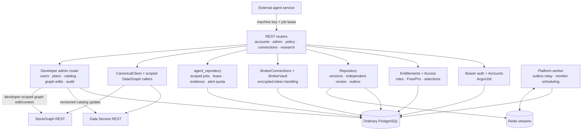

# Platform system design

Package: `services/platform/` (`marketgraph-platform`), with separate `platform-api`
and `platform-worker` processes and its own ordinary PostgreSQL database
(`marketgraph_platform`) on the shared PostgreSQL server.

## Responsibilities and boundaries

Platform owns public accounts and sessions, combinable application roles,
Free/Pro plan policy, selected stocks, usage/quota accounting, professional
submission/review history, encrypted personal Upstox credentials, user-facing
REST authorization, job leases, evidence ledgers, outputs and alerts. Billing is
disabled; Pro is manually assigned by the developer. Platform never connects to
FalkorDB or TimescaleDB. It calls Data and StockGraph through service-key-protected
REST APIs. The worker relays transactional outbox records and schedules monitors;
it does not execute agent jobs.

### Components



## Implemented OOP LLD class diagram

The application layer now contains explicit use cases and structural ports. The
PostgreSQL repository implements those operations while keeping transactions,
account locks, usage quotas and transactional outbox writes inside the database
adapter. Access snapshots and principals are immutable.

```mermaid
classDiagram
    class PlatformRoutes {
      <<FastAPI controllers>>
      +authenticate()
      +create_contribution()
      +submit_research()
      +get_agent_context()
    }
    class AccountService {
      +signup(email, name, password)
      +login(email, password)
      +change_password(user, current, next)
      +bootstrap_developer()
    }
    class AccountAdministrationService {
      +bootstrap_developer()
      +update_user(actor, user_id, changes)
      +revoke_sessions(actor, user_id)
    }
    class EntitlementService {
      +access(user_id) AccessSnapshot
      +check(user, feature, tickers) AccessSnapshot
      +select(user, tickers)
      +usage(user)
    }
    class AccessSnapshot {
      <<immutable value object>>
      -Principal principal
      -PlanPolicy policy
      -tuple tickers
      +allows(feature)
      +require(feature, tickers, single)
      +require_job(job)
    }
    class PlanPolicy {
      <<immutable value object>>
      +plan
      +active_stock_limit
      +monthly_alert_limit
      +frozenset features
      +revision
    }
    class Principal {
      <<immutable value object>>
      +UUID id
      +tuple roles
      +plan
      +is_developer
      +disabled
    }
    class ContributionService {
      +create(user, content, idempotency_key)
      +add_version(user, contribution_id, content)
      +submit(user, contribution_id, revision)
      +review(reviewer, contribution_id, decision)
      +retract(user, contribution_id, revision)
    }
    class ResearchSubmissionService {
      +submit(user, request, key, kind, conversation_id)
    }
    class AgentContextService {
      +stock_context(job, lease, ticker, window, access)
      +search_documents(job, lease, ticker, query, access)
    }
    class BrokerConnectionService {
      +connect(user, token)
      +status(user_id)
      +disconnect(user_id)
      +read(user_id, path, params)
    }
    class BrokerVault {
      -SecretStr key
      +encrypt(owner_id, token) bytes
      +decrypt(owner_id, ciphertext) SecretStr
    }
    class DataClientPort {
      <<Protocol>>
      +get(path, params, headers)
      +validate_ticker(ticker)
      +validate_citations(content)
    }
    class GraphClientPort {
      <<Protocol>>
      +get(path, params, evidence_scope, developer)
      +request(method, path, body, params)
    }
    class AccountRepositoryPort {
      <<Protocol>>
      +create_account(...)
      +create_login_session(...)
      +update_account(...)
      +revoke_account_sessions(...)
    }
    class AccessRepositoryPort {
      <<Protocol>>
      +load_access_snapshot(user_id)
      +replace_active_stocks(user_id, tickers)
      +usage_summary(user_id)
    }
    class BrokerRepositoryPort {
      <<Protocol>>
      +save_broker_credential(user_id, ciphertext)
      +read_broker_credential(user_id)
      +disconnect_broker(user_id)
    }
    class ContributionRepositoryPort {
      <<Protocol>>
      +create_contribution(...)
      +review(...)
      +retract(...)
    }
    class JobRepositoryPort {
      <<Protocol>>
      +create_research_job(...)
      +reserve_tool_call(...)
      +register_evidence(...)
    }
    class EvidenceRepositoryPort {
      <<Protocol>>
      +published(ticker, limit, offset)
      +current_professional_evidence(version_id)
    }
    class AuditRepositoryPort {
      <<Protocol>>
      +audit_action(actor_id, action, target_id, details)
    }
    class CredentialVaultPort {
      <<Protocol>>
      +encrypt(owner_id, token)
      +decrypt(owner_id, ciphertext)
    }
    class Repository {
      <<PostgreSQL adapter>>
      +health_check()
      +write_outbox_event(connection, event)
      +claim_outbox()
      +finish_outbox(event_id, lease_id)
    }
    class HttpDataClient {
      <<HTTP adapter>>
      +get(path, params, headers)
      +post_internal(path, payload)
      +patch_internal(path, payload)
      +validate_ticker(ticker)
    }
    class HttpGraphClient {
      <<HTTP adapter>>
      +get(path, params, evidence_scope, developer)
      +request(method, path, body, params)
    }
    class AgentRepositoryModule {
      <<job lifecycle adapter functions>>
      +claim_job()
      +heartbeat()
      +complete_job()
      +schedule_due_monitors()
    }

    PlatformRoutes --> AccountService
    PlatformRoutes --> AccountAdministrationService
    PlatformRoutes --> EntitlementService
    PlatformRoutes --> ContributionService
    PlatformRoutes --> ResearchSubmissionService
    PlatformRoutes --> AgentContextService
    PlatformRoutes --> BrokerConnectionService
    AccountAdministrationService --> AccountService
    EntitlementService --> AccessRepositoryPort
    EntitlementService --> AccessSnapshot
    AccessSnapshot *-- Principal
    AccessSnapshot *-- PlanPolicy
    AccountService --> AccountRepositoryPort
    ContributionService --> ContributionRepositoryPort
    ContributionService --> DataClientPort
    ResearchSubmissionService --> EntitlementService
    ResearchSubmissionService --> JobRepositoryPort
    ResearchSubmissionService --> DataClientPort
    ResearchSubmissionService --> AuditRepositoryPort
    AgentContextService --> JobRepositoryPort
    AgentContextService --> EvidenceRepositoryPort
    AgentContextService --> DataClientPort
    AgentContextService --> GraphClientPort
    BrokerConnectionService --> BrokerRepositoryPort
    BrokerConnectionService --> CredentialVaultPort
    BrokerConnectionService --> DataClientPort
    BrokerVault ..|> CredentialVaultPort
    HttpDataClient ..|> DataClientPort
    HttpGraphClient ..|> GraphClientPort
    Repository ..|> AccountRepositoryPort
    Repository ..|> AccessRepositoryPort
    Repository ..|> BrokerRepositoryPort
    Repository ..|> ContributionRepositoryPort
    Repository ..|> JobRepositoryPort
    Repository ..|> EvidenceRepositoryPort
    Repository ..|> AuditRepositoryPort
```



## Original baseline class diagram (historical)

```mermaid
classDiagram
    class Principal {
      +UUID id
      +roles: list
      +plan: FREE|PRO
      +is_developer: bool
      +professional_verified: bool
    }
    class Accounts {
      +signup(name, email, password)
      +request_code(email, purpose)
      +consume_code(email, purpose, code, password)
      +login(email, password)
      +change_password(user, current, next)
      +bootstrap_developer()
      +update_user(actor, user_id, changes)
      +revoke_sessions(actor, user_id)
    }
    class Repository {
      +authenticate(token_digest)
      +create_contribution(user, input, idempotency_key)
      +review(contribution, reviewer, revision, decision)
      +published(ticker, limit, offset)
      +claim_outbox()
    }
    class Access {
      +user: Principal
      +policy: dict
      +tickers: tuple
      +allows(feature)
      +require(feature, tickers, single)
      +require_job(job)
    }
    class Entitlements {
      +access(user_id) Access
      +check(user, feature, tickers, single) Access
      +select(user, tickers)
      +usage(user)
    }
    class BrokerVault {
      -key: SecretStr
      +encrypt(owner, token) bytes
      +decrypt(owner, ciphertext) SecretStr
    }
    class BrokerConnections {
      +connect(user, token)
      +status(user_id)
      +disconnect(user_id)
      +headers_for(user_id)
      +read(user_id, path, params)
    }
    class CanonicalClient {
      +get(path, params, headers)
      +post_internal(path, payload, headers)
      +patch_internal(path, payload, headers)
      +validate_ticker(ticker)
      +validate_citations(content)
    }
    class DeveloperAdminRouter {
      <<FastAPI router builder>>
      +update_user(user_id, changes)
      +update_plan(plan, policy)
      +read_user_records(owner_id, resource, pagination)
      +read_graph_context(ticker, window, pagination)
      +update_catalog_entity(kind, entity_id, changes, reason)
      +create_or_update_or_delete_link(edge_id, values)
      +read_audit(limit, offset)
    }
    class CatalogEdit {
      <<request DTO>>
      +changes: dict
      +reason: str
    }
    class DeveloperEdgeEdit {
      <<request DTO>>
      +relation: str
      +rationale: str
      +confidence: float
      +metadata: dict
      +reason: str
    }
    class GraphAdminProxy {
      <<module function>>
      +request(method, path, body, params)
    }
    class AdminAudit {
      <<module function>>
      +audit_admin(connection, actor, action, target, details)
    }
    class AgentRepositoryModule {
      <<module functions>>
      +create_job(owner, actor, request)
      +claim_job()
      +reserve_tool_call(job, lease)
      +register_evidence(job, lease, sources)
      +complete_job(job, lease, result)
    }
    class AgentWorkerContract {
      <<REST boundary>>
      +claim(X-Agent-Key)
      +context(X-Agent-Key, X-Job-Lease)
      +heartbeat(X-Agent-Key, X-Job-Lease)
      +complete(X-Agent-Key, X-Job-Lease)
    }
    class WorkerModule {
      <<module functions>>
      +relay_once()
      +run()
    }
    class Settings
    Accounts --> Repository
    Accounts --> Settings
    Entitlements --> Access
    Entitlements --> Repository
    BrokerConnections --> BrokerVault
    BrokerConnections --> CanonicalClient
    AgentRepositoryModule --> Entitlements : rechecks current policy
    AgentWorkerContract --> AgentRepositoryModule
    WorkerModule --> Repository
    WorkerModule --> Settings
    DeveloperAdminRouter --> Accounts
    DeveloperAdminRouter --> CanonicalClient
    DeveloperAdminRouter --> GraphAdminProxy
    DeveloperAdminRouter --> AdminAudit
    DeveloperAdminRouter --> CatalogEdit
    DeveloperAdminRouter --> DeveloperEdgeEdit
```



## Key decisions and sequences

### Access evaluation

`current_user` validates an opaque session digest and operational request budget.
Feature routes load current user status, roles, plan policy and active-stock
selection from PostgreSQL. Free uses a ten-stock selection and ten newly created
alerts per Asia/Kolkata calendar month. Pro unlocks broader research/discovery and
professional intelligence. The developer identity comes only from environment
bootstrap and bypasses per-user ownership/plan/quota checks; privileged changes
are audited. Global provider, LLM and queue budgets still apply.

The same policy is rechecked when jobs are submitted, claimed, given evidence,
and completed. Professional records are kept in SQL with immutable versions,
review decisions, citations, validity and outbox events. Non-developer authors
require an independent reviewer; developer self-approval is permitted and logged.

The environment-managed developer identity is the only admin principal. It can
change user roles and professional verification, assign Free/Pro plans, inspect
other users' supported records, revoke sessions and use supported application
routes across ownership boundaries. Canonical graph edits are proxied to Data and
use SQL history plus the outbox; manual graph-link edits are proxied to StockGraph.
Administrative changes are recorded in the Platform audit table.

### Broker connection

```mermaid
sequenceDiagram
    actor User
    participant P as Platform API
    participant V as BrokerVault
    participant DB as Platform PostgreSQL
    participant D as Data Service
    User->>P: PUT token (authenticated)
    P->>D: Validate token with bounded market-data request
    D-->>P: Connected / rejected / provider unavailable
    P->>V: Encrypt token with owner-bound authenticated encryption
    P->>DB: Store ciphertext and increment credential revision
    Note over P,D: On-demand data calls decrypt just in time and use credential-scoped client/cache
    P->>D: Market read + personal credential headers
    D-->>P: User-scoped market response
    P-->>User: Data/status; never the stored token
```

Scheduled ingestion never uses a personal user token. If a saved personal token
is rejected, the user must reconnect; Platform does not silently substitute the
shared environment credential. Disconnecting explicitly restores the shared
market-data fallback. Portfolio, holdings/funds endpoints and trading are excluded.

### External-agent job lifecycle

Platform stores canonical job scope, owner, initiating developer if applicable,
required plan, idempotency key, lease, evidence ledger, result and alerts. An agent
claims through `X-Agent-Key`; all subsequent calls require `X-Job-Lease`. Context
is assembled by Platform from graph and SQL services after access checks. Completion
validates current evidence/version/expiry, deduplicates alerts, applies monthly
quota transactionally, and stores citations with the output. A retry with the same
result is idempotent.

## Storage and migration

Migrations `001` through `004` are ordered and checksummed. Accounts and plan
policy live in ordinary PostgreSQL tables alongside contributions, job state,
audits, sessions, selection and encrypted credentials. Back up Platform data
before applying migrations. Restore tooling must include every migrated table.

Public signup creates a Free account that can log in immediately. Authenticated
users can change their password by providing the current password.
