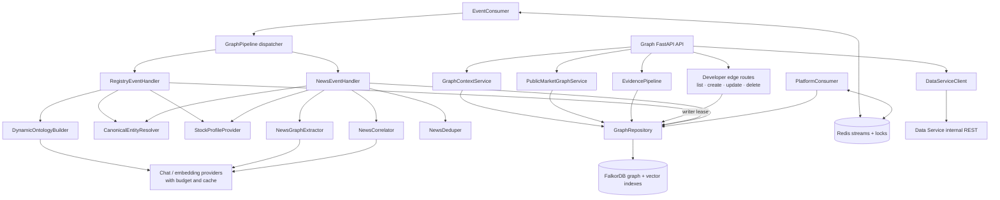
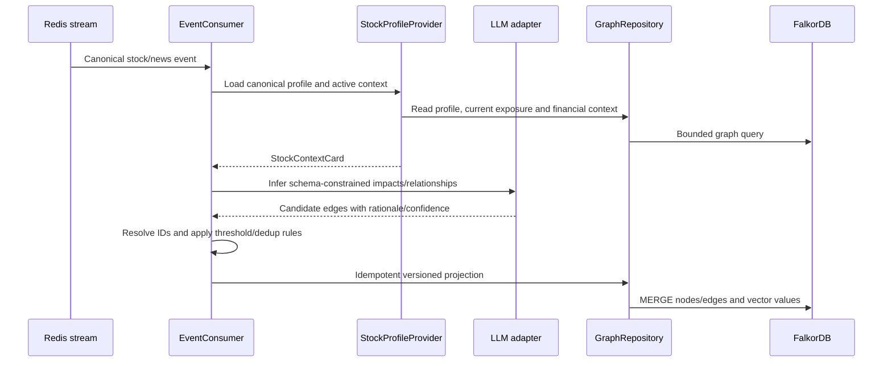

# StockGraph system design

Package: `services/stockgraph/` (`stockgraph-service`), deployed processes:
`graph-api` and `graph-worker`. The local `stockgraph-mcp` executable uses stdio
and proxies user requests through Platform authentication.

## Responsibilities

StockGraph owns FalkorDB graph state, graph traversal, vector search and narrative
evidence processing. It accepts canonical change events, builds and versions
relationships, correlates news, and returns bounded context. Numeric financial
series remain Data-owned. Public graph-domain endpoints are protected by the
internal service key; Platform supplies professional-evidence access scope.

### Components

## Application class diagram

The application owns these structural protocols. The runtime constructs the
FalkorDB and model adapters and supplies them to the application. `GraphPipeline`
accepts injected handlers and otherwise creates its default handlers.

```mermaid
classDiagram
    class GraphPipeline {
      +process(event)
    }
    class RegistryEventHandler {
      +handle(event)
    }
    class NewsEventHandler {
      +handle(event)
      +route(news, resolver, chat)
    }
    class StockProfileProvider {
      +build_context_card(ticker) StockContextCard
    }
    class CanonicalEntityResolver {
      +resolve_stock(text)
      +resolve_registry(text)
      +list_stocks()
      +registry_catalog()
    }
    class DynamicOntologyBuilder {
      +infer_edges(card)
      +filter_edges(ticker, edges, time)
    }
    class NewsDeduper {
      +find_semantic_duplicate(embedding, ticker, time)
    }
    class NewsGraphExtractor {
      +infer(news, cards)
      +infer_market_impacts(news)
    }
    class NewsCorrelator {
      +correlate(repo, news)
    }
    class GraphContextService {
      +get_context(ticker, window, pagination)
    }
    class EvidencePipeline {
      +process(event)
    }
    class RegistryStore {
      <<Protocol>>
      +catalog()
      +project_entity()
      +rotate_dynamic_ontology_edges()
    }
    class NewsStore {
      <<Protocol>>
      +find_near_dup()
      +reconcile_news_impacts()
    }
    class StockProfileReader {
      <<Protocol>>
      +get_entity(kind, id)
      +get_active_exposures(ticker)
    }
    class GuidanceReader {
      <<Protocol>>
      +guidance_highlights(ticker)
    }
    class GraphContextReader {
      <<Protocol>>
      +context_page(ticker, start, end, offset, limit)
    }
    class ProfessionalEvidenceReader {
      <<Protocol>>
      +professional_page(ticker, start, end, offset, limit)
    }
    class EvidenceWriter {
      <<Protocol>>
      +project_professional(event, payload)
      +project_document(event)
    }
    class ChatModel {
      <<Protocol>>
      +complete_json(prompt, schema)
    }
    class EmbeddingModel {
      <<Protocol>>
      +embed_one(text)
    }
    class GraphRepository
    class EvidenceRepository
    class LiteLLMChatProvider
    class LiteLLMEmbeddingProvider

    GraphPipeline --> RegistryEventHandler
    GraphPipeline --> NewsEventHandler
    RegistryEventHandler --> RegistryStore
    RegistryEventHandler --> NewsEventHandler : historical replay
    RegistryEventHandler ..> StockProfileProvider
    RegistryEventHandler ..> DynamicOntologyBuilder
    RegistryEventHandler --> EmbeddingModel
    NewsEventHandler --> NewsStore
    NewsEventHandler ..> NewsDeduper
    NewsEventHandler ..> NewsGraphExtractor
    NewsEventHandler ..> NewsCorrelator
    StockProfileProvider --> StockProfileReader
    StockProfileProvider --> GuidanceReader
    DynamicOntologyBuilder --> CanonicalEntityResolver
    DynamicOntologyBuilder --> ChatModel
    NewsGraphExtractor --> CanonicalEntityResolver
    NewsGraphExtractor --> ChatModel
    NewsCorrelator --> ChatModel
    GraphContextService --> GraphContextReader
    GraphContextService --> ProfessionalEvidenceReader
    EvidencePipeline --> EvidenceWriter
    EvidencePipeline --> EmbeddingModel
    GraphRepository ..|> RegistryStore
    GraphRepository ..|> NewsStore
    GraphRepository ..|> StockProfileReader
    GraphRepository ..|> GraphContextReader
    EvidenceRepository ..|> GuidanceReader
    EvidenceRepository ..|> ProfessionalEvidenceReader
    EvidenceRepository ..|> EvidenceWriter
    LiteLLMChatProvider ..|> ChatModel
    LiteLLMEmbeddingProvider ..|> EmbeddingModel
```

The protocols describe structural contracts; adapters do not need to inherit
from them. Inference failures raise `InferenceError`, while an empty successful
model result remains an empty list. News-impact reconciliation is required of
the news store, so replacing a repository cannot silently switch to merge-only
writes.

## Projection and access flow

The event worker handles canonical SQL outbox events; the Platform stream worker
applies versioned, approved professional evidence. Graph writes are idempotent
and preserve version history. A Platform request sends either ordinary or
professional evidence scope. StockGraph filters professional graph results before
page limits and cache keys, and includes them only when the caller is entitled.

Numerical values requiring provenance are fetched from Data and retain their
provider timestamp. Graph traversals use fixed `LAST_6M` / `LAST_1Y` windows and
bounded pagination. Canonical catalog changes arrive through Data's event stream.
Developer-created links use the internal mutation API, validated node references,
and the graph-writer lease; updates retain link edit history and links appear in
stock context. Other provider, inferred and baseline edges remain owned by their
normal versioned projection flows.
