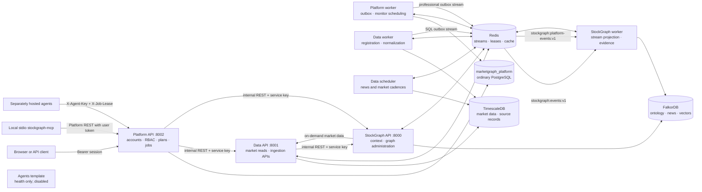
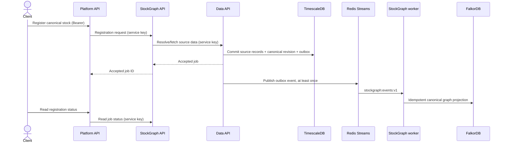

# Whole-project system design

## Runtime topology and ownership

Each backend package owns its domain and storage. Platform has its own logical
ordinary PostgreSQL database on the existing PostgreSQL server. TimescaleDB
continues to own market and source data; FalkorDB owns graph relationships and
vector indexes. Redis provides stream transport, leases, cache and coordination.



The Agents template is intentionally isolated in the diagram: it has no runtime
connection to Platform. It is omitted from ordinary Compose startup.

## Responsibility and data flow

| Service | Owns | Reads from | Writes to |
|---|---|---|---|
| Platform | Accounts, roles, plans, active stocks, quotas, contributions, sessions, broker credentials, jobs and alerts | Data and Graph internal APIs | Platform PostgreSQL, Redis streams |
| Data | Canonical SQL instrument registry, source payloads, market series, documents and ingestion runs | Upstox/exchange/news providers; Platform-scoped credential headers for on-demand data | TimescaleDB, Redis streams |
| StockGraph | Canonical graph projection, exposures, news impacts/correlations, professional graph evidence and vector indexes | Data API and both Redis streams | FalkorDB, Redis coordination |
| Agents template | No domain records | Nothing at runtime | Health response only |

Numbers and source payloads stay in SQL. FalkorDB stores entities, relationships,
text evidence and vectors; graph numeric context is fetched from Data when needed.
Platform never connects to either database directly. The services communicate
through REST and versioned Redis events, not sibling imports.

## Main asynchronous flows

### Stock registration and graph projection



### Research and opportunity alerts

```mermaid
sequenceDiagram
    actor User
    participant P as Platform API
    participant DB as Platform PostgreSQL
    participant A as External agent service
    participant D as Data API
    participant G as StockGraph API
    User->>P: Submit research / discovery request
    P->>DB: Check current role, plan, stocks and idempotency
    P->>DB: Persist scoped job and conversation message
    A->>P: Claim job (X-Agent-Key)
    P-->>A: Owner, job scope and lease (X-Job-Lease)
    A->>P: Request context within ticker scope
    P->>G: Graph context with evidence-access scope
    P->>D: SQL financial context
    P->>DB: Revalidate policy and record supplied evidence
    P-->>A: Cited sources and material versions
    A->>P: Complete with cited result and alerts
    P->>DB: Revalidate lease/evidence; dedupe and allocate quota
    User->>P: Read authorized result / alerts
```

Authorization is checked again at job claim, context retrieval and completion.
Professional graph evidence is filtered by StockGraph before pagination; SQL
professional sources are queried only for a currently permitted job. Platform
stores results with a required plan so existing outputs follow current access.

## Trust and recovery boundaries

- Public requests authenticate at Platform. Direct market-data and graph domain
  routes require `MARKETGRAPH_INTERNAL_SERVICE_KEY`.
- External agents authenticate with a separate machine key and a per-job lease.
  They never receive bearer sessions, database credentials or Upstox tokens.
- Optional per-user Upstox tokens are encrypted at rest by Platform and forwarded
  only to Data for a user-scoped provider request. Shared ingestion uses the
  environment-owned provider credential. Trading is not enabled.
- Data source changes and Platform professional publication use transactional
  SQL outboxes. Consumers are idempotent because Redis delivery is at least once.
- Job lease, evidence and alert writes are transactional. Acknowledgment/retry
  does not duplicate alerts or charge the per-user monthly count twice.
- Redis provider/model budgets and global operational limits stay independent of
  a user's Free/Pro policy. Database backups and migrations are operational gates.

## Deferred pieces

The browser frontend, payments (provider undecided), live order execution, a
concrete agent implementation and remote HTTP MCP gateways are not part of the deployed design.
The existing local stdio MCP tools call Platform's authenticated REST APIs.
