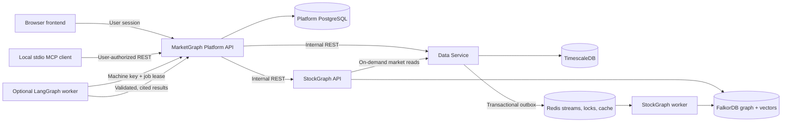

# StockGraph Project Guide

StockGraph is a temporal graph and market-data platform for researching Indian equities. It brings together company and market data, exchange and media events, and relationships between companies, sectors, commodities, and macro factors. The goal is to help a researcher follow both direct events and indirect effects, with time-bounded context and source provenance.

This guide describes the current repository and runtime. The service specifications linked below remain the detailed references for API schemas, operations, and access policy.

## Project at a glance

- **StockGraph** builds and serves a canonical market graph, contextual news links, and vector-backed text retrieval.
- **The Data Service** resolves securities and owns source ingestion, market history, and other numeric records in PostgreSQL/TimescaleDB.
- **MarketGraph Platform** provides accounts, permissions, user workflows, and a separate ordinary PostgreSQL database.
- **The browser app** provides the landing page, account screens, and authenticated research workspace.
- **StockGraph Agents** is an optional, developer-only LangGraph pilot for cited research, recent-event discovery, and monitoring.

The platform is designed for research and context. It does not place orders or implement a live trading decision engine. Payments are disabled; Pro access is assigned manually by a developer.

## Architecture and ownership

Each backend package owns its database and responsibilities. Services communicate over REST and versioned Redis streams rather than importing one another's Python packages.



| Component | Owns | Main responsibilities |
| --- | --- | --- |
| **Data Service** (`services/upstox/`) | PostgreSQL/TimescaleDB | Canonical SQL instrument registry, source payloads, company and financial data, market series, documents, ingestion jobs, and the source-event outbox. Integrates with Upstox, news providers, and exchange sources through adapters. |
| **StockGraph** (`services/stockgraph/`) | FalkorDB and graph processing state in Redis | Canonical graph projection, ontology relationships, news impact and correlation links, graph traversal, vector search, and bounded context APIs. Runs a separate graph worker. |
| **MarketGraph Platform** (`services/platform/`) | Its own ordinary PostgreSQL database | Accounts, sessions, roles, Free/Pro policy, active stocks, quotas, professional evidence and review history, user jobs, evidence ledgers, alerts, and encrypted personal Upstox credentials. It calls Data and StockGraph through protected APIs. |
| **Agents** (`services/agents/`) | No application database | Optional LangGraph worker that claims Platform jobs and uses leased, scoped Platform tools. It cannot connect directly to the application databases or broker credentials. |
| **Frontend** (`frontend/`) | Browser session state | Landing page, account access, research workspace, stock connections, watchlists, research, monitoring, and developer/professional screens. It is a Vite app and is not a Compose service. |

The Platform database is a separate logical database on the PostgreSQL server used by the Data Service; its tables and credentials are separate. FalkorDB stores graph relationships and vector indexes. Numeric market history and source payloads remain in SQL. Redis carries outbox streams and coordinates leases, locks, caches, and budgets.

## Main data flow

### Stock registration and graph projection

1. A user or trusted client requests a stock through the Platform or StockGraph registration API.
2. The Data Service resolves an official NSE/BSE identity, collects supported source data, and commits its catalog revision, SQL records, and outbox event together.
3. The outbox publisher sends a versioned event to Redis. Delivery is at least once, so consumers use event IDs, revisions, and idempotent graph merges.
4. The StockGraph worker projects the canonical entity and its context into FalkorDB, creates profile embeddings, and runs configured semantic inference when enabled.
5. The Platform exposes job status so the client can distinguish data collection, graph processing, completion, and failure. Disabled or failed inference is not reported as completed semantic processing.

### News and market data

- The Data scheduler fetches news hourly (minute zero, Asia/Kolkata) and stages provider payloads before graph processing. Provider adapters normalize symbols and reject entities that do not resolve to the canonical registry.
- News passes through exact, headline, and semantic deduplication. Canonical stories can be routed to stocks or market entities, then correlated with other news. Exchange filings outrank media sources when summaries conflict.
- Market checkpoints run around 09:30 IST (`OPEN`) and 19:00 IST (`CLOSE`) on trading days. NSE Bhavcopy is the primary source for official delivery and turnover data. The Data Service also serves daily OHLCV candles and other supported market reads.
- Source values retain provider and as-of provenance. A provider revision is staged as a new vintage instead of silently replacing the original payload.

### Research, evidence, and alerts

1. The Platform checks the user's role, plan, active-stock scope, quota, and request idempotency before creating work.
2. The optional agent worker claims developer-owned pilot jobs using a machine key and a per-job lease. External agents can use the same Platform contract.
3. The Platform supplies bounded Graph and Data context, source excerpts, and stable evidence versions through scoped APIs. The agent does not query FalkorDB or TimescaleDB directly.
4. Model answers must cite evidence actually supplied to the job. The Platform validates references, quotes, revisions, permissions, lease ownership, and alert limits before saving a result.
5. The browser reads authorized research results and in-app alerts from the Platform.

Lost leases stop execution. Redis streams are at-least-once; outbox relays, graph projection, and result completion are designed for safe retries.

## Data and graph model

### SQL: source records and numeric data

The Data Service owns the canonical SQL instrument catalog, company and financial data, shareholding history, daily candles and checkpoints, raw provider payloads, documents, ingestion runs, and source watermarks. SQL remains the source for numeric financial and market history. A graph read can request related SQL context through the Data API; the graph is not a replacement time-series store.

The company directory is based on exchange company equities and excludes funds and ETFs. Optional live market reads are returned by the Data API and are not automatically treated as graph updates.

### FalkorDB: canonical entities and relationships

The graph uses canonical IDs and includes `Stock`, `Sector`, `Commodity`, and `MacroFactor` entities. There is no `Currency` node type; USD/INR is represented as the `USD_INR_FX` macro factor. Relationships include curated baseline exposures and validated inferred links such as:

- `EXPOSED_TO` and `SENSITIVE_TO_MACRO`
- `BELONGS_TO`, `SUPPLIES_TO`, and `COMPETES_WITH`
- Commodity-to-commodity `RELATED_TO`
- News-to-stock impact, news-to-market shock, and cross-news correlation links

The canonical registry is maintained by the Data Service. The graph receives committed catalog changes through its event projection; an LLM or scraper cannot invent entity IDs. Dynamic relationship changes carry confidence and rationale and are filtered using the configured confidence floor.

FalkorDB also stores textual graph evidence and embeddings used for similarity search. Numeric time-series and provider payloads stay in SQL. Graph queries return bounded nodes, edges, evidence, and provenance for a stock and a supported time window.

### Time windows and provenance

StockGraph context APIs accept `LAST_6M` or `LAST_1Y`, not arbitrary date ranges or an all-time request. Point-in-time events are filtered by event time; versioned graph records use validity intervals. Result sections are bounded and paginated. Continue a paginated read with the returned snapshot timestamp until the API reports there is no next page.

Financial and market values should retain their source and as-of information. A relationship's rationale and confidence describe an inference; they do not replace the original source evidence.

## How the project uses Meta AI

### Model and serving path

The checked-in `.env.example` selects Meta's **Muse Spark Open** chat model using the model ID `meta-models/muse-spark-open-1026`. The project sends chat requests to **Baseten's OpenAI-compatible inference endpoint**, using **LiteLLM** as the provider adapter. Meta supplies the model; Baseten is the configured serving provider. This is not a direct call to a Meta-hosted API.

The sample configuration sets `LLM_PROVIDER=baseten`, `BASETEN_API_BASE=https://inference.baseten.co/v1`, and selects Muse Spark for both `LLM_CHAT_MODEL` and `LLM_ONTOLOGY_MODEL`. A deployment can choose another supported provider or model through environment settings without changing application code.

### What the chat model does

In StockGraph, the configured chat model contributes to:

1. **Dynamic ontology inference:** it evaluates a stock's business profile, available financial/guidance context, current graph exposures, and canonical entity catalog to propose relationships.
2. **News processing:** it can review whether an item is relevant, route a canonical story to directly or indirectly affected entities, and assess possible correlations between news events.
3. **Optional agent research:** the LangGraph pilot can use the same chat model for cited research, discovery, or monitoring. `AGENTS_LLM_CHAT_MODEL` can override the shared chat model for the worker.

Model output is treated as a proposal. StockGraph validates structured output, entity IDs, relationship types, confidence, and required rationale before graph writes. Agent results must cite exact excerpts and material versions offered by Platform tools; unsupported output is rejected or marked insufficient rather than presented as verified fact.

### Embeddings are a separate model path

Muse Spark is used for chat inference, not embeddings. The sample configuration uses OpenAI `text-embedding-3-small` with a separate `OPENAI_API_KEY` and a 1536-dimensional vector index. Gemini embeddings are also configurable. Embeddings support vector similarity for profiles, news, and text evidence; changing the embedding model requires a planned re-embedding and index migration.

### Controls, cost, and limitations

- `.env.example` leaves `LLM_ENABLED=false`, the Baseten key empty, and `AGENTS_ENABLED=false`. Copy the example to the ignored local `.env` and configure credentials before enabling live calls.
- StockGraph has a token limit, Redis-backed embedding cache, and monthly spend guard. Per-token prices are operator-supplied estimates, not provider invoices.
- The agent pilot additionally requires explicit Platform model rates, job/month budgets, a machine key, and an enabled worker. Platform reserves and settles those estimated costs. Agent call logs record model/provider, token usage, status, duration, and estimate metadata; prompts, responses, and credentials are not written to those logs.
- Live model calls send bounded prompts and selected source context to the configured inference provider. Never place API keys, broker tokens, or other secrets in source text or research prompts.
- Muse Spark does not supply market data, establish the truth of an event, or make trading decisions for the platform. The system has no order execution or BUY/SELL/HOLD decision engine. Agent opportunity outputs are qualitative, evidence-constrained research for a developer pilot, not trading instructions.

See [Meta model and AI usage](docs/AI_AND_MODEL_USAGE.md) and [LLM provider configuration](docs/LLM_PROVIDER_CONFIGURATION.md) for the detailed workflow and environment settings.

## Platform access and product status

Public users sign up as Free users. The Platform enforces active-stock limits, research permissions, professional evidence access, monitoring, and alert quotas. Professional evidence has version history and an independent review workflow for ordinary contributors; the developer identity has audited administrative privileges. Pro is assigned manually, and billing is disabled.

The LangGraph agent worker is an opt-in, developer-only pilot and is excluded from ordinary Compose startup. Its health-only `agents-template` profile is separate. Local MCP access uses stdio and authenticated Platform APIs; a remote HTTP MCP gateway is not deployed.

## Repository map

```text
services/upstox/      Data Service: provider adapters, SQL repositories, APIs, jobs
services/stockgraph/  Graph API, FalkorDB adapters, inference, graph worker, MCP
services/platform/    Accounts, permissions, evidence, jobs, budgets, alerts
services/agents/      Opt-in LangGraph worker and health-only template
frontend/             Vite landing page, account UI, and research workspace
contracts/             Versioned cross-service event contracts
scripts/               Population, backup/reset, and agent-pilot operations
docs/                  Service boundaries, APIs, AI setup, policy, and diagrams
tests/                 Cross-service tests
```

The root `pyproject.toml` defines a uv workspace for the four Python packages; it is not a deployable application package. Each backend image installs its own service package.

## Local development

Prerequisites: Python 3.12 or later, `uv`, Docker Compose, and Node.js/npm for the browser app.

```powershell
Copy-Item .env.example .env
uv sync --all-packages --group dev --inexact
docker compose up -d --build
```

Local API documentation is available at:

- Platform: <http://localhost:8002/docs>
- Data Service: <http://localhost:8001/docs>
- StockGraph: <http://localhost:8000/docs>

The frontend runs separately:

```powershell
cd frontend
npm install
npm run dev
```

Vite proxies `/api` to the Platform API by default. Do not expose internal Data or Graph credentials to the browser. See [the service operating guide](docs/04_SERVICE_BOUNDARIES.md) and [frontend guide](frontend/README.md) for migration, deployment, and recovery details.

## Further reading

- [Service boundaries and operating guide](docs/04_SERVICE_BOUNDARIES.md)
- [Whole-project architecture](docs/architecture/whole-system-design.md)
- [Data Service design](docs/architecture/data-service.md)
- [StockGraph design](docs/architecture/stockgraph-service.md)
- [Platform design](docs/architecture/platform-service.md)
- [Agents design and pilot setup](docs/architecture/agents-template.md) · [agent guide](services/agents/README.md)
- [API access and data contracts](docs/API_ACCESS_AND_DATA_CONTRACTS.md)
- [Phase 2 accounts and permissions](docs/PHASE2_PLATFORM.md)
